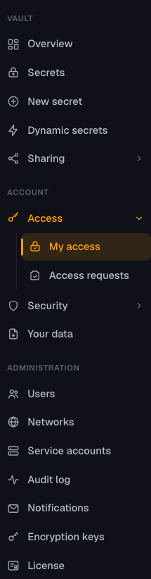
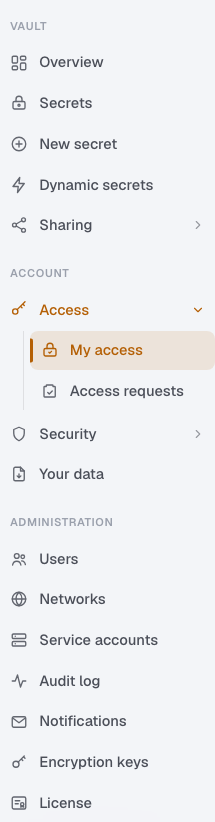
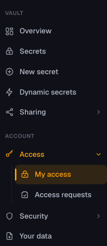
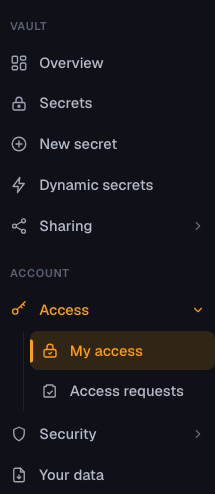
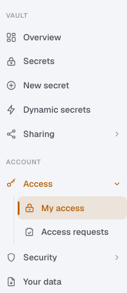

# #49 app-shell evidence

Baseline: `caf052f4d438831aaef227ae27207dda5536c857`, on `angular-migration`.

`GET /api/ui/me` evaluates each Area through `IAuthorizationService` using the named policy enforced
by its pages: `Session` or `AdminOnly`. Angular maps the returned keys to presentation only. The
Standard account receives 13 Areas; the administrator receives those plus seven administration
Areas. The sidebar has one extra Secrets entry (New secret) and leaves Profile to #50.

## Verification

Run on Node 24.22.0 and .NET SDK 10.0.402.

| Check | Result |
| --- | --- |
| `dotnet restore --locked-mode` | Passed |
| `dotnet build EclipsVault.slnx -c Release` | Passed, no warnings |
| .NET unit suite with the documented hang guard | 596 passed |
| Production integration suite with SQL Server and the documented hang guard | 43 passed |
| `npm run lint` (includes browser TypeScript checking and lint guard tests) | Passed |
| `npm test -- --watch=false` | 22 passed |
| `npm run test:build-checks` | 15 passed |
| `npm run build` | Passed, including runtime dependency and inline-code gates |
| `npm run check:api-types` | Passed; generated types committed |
| `npm audit --audit-level=high` | No vulnerabilities |
| `dotnet list package --vulnerable --include-transitive` | No vulnerable packages |
| Agent guardrail tests | 6 passed |
| `npm run e2e` | 3 passed; both accounts/themes, cross-UI navigation, Trusted Types and revocation |
| `npm run e2e:verify-guards` | Passed; all 8 deliberate failures detected by the shared fixture |

Both browser runs reuse one image built from the final tree, `E2E_IMAGE=eclipsvault:e2e-49-r2`,
image ID `sha256:b367fc1c5a6a23d07abb8a4045bfa6f8c7a71f047f2b5da0affc1641b84a72c2`. Its screenshots
are byte-identical to those from the pre-review image.
Each run creates its own throwaway production vault and SQL Server with real password/TOTP sign-in,
TLS, Secure cookies, production CSP and Trusted Types. No development seed accounts are used.

## Visual comparison

The browser compares the real Legacy and Angular navigation on the same session: section and entry
labels, ordering, URLs, SVG geometry, active entry, expanded groups, colors, typography and spacing.
It also proves that My access uses the router, Legacy links replace the document, and returning to
Angular keeps the same session without another sign-in. Standard has no administration links in
the DOM. Screenshots crop to navigation content; the command trigger and account menu belong to
#51 and #50 respectively.

The Legacy reference uses MVC's existing optional-id route `/Access/Index/legacy`, while `/Access`
and `/Access/Index` serve Angular. This compares the same active page before #52 removes its Razor
controller. The test asserts and normalizes the reference link's ambient optional id to `/Access`.
For the light Angular capture the browser applies `data-theme="light"` directly: theme boot and
switching remain in #50. Both token palettes are exercised here without adding that feature.

| Account / theme | Legacy | Angular |
| --- | --- | --- |
| Administrator / dark |  |  |
| Administrator / light |  |  |
| Standard / dark |  |  |
| Standard / light |  |  |

## Security review

No defects. The `Session` policy is the previous default `RequireAuthenticatedUser()` rule under a
name, so no controller gained or lost access. Every Area key matches its controller's policy. Areas
are evaluated per request against the validated cookie principal (revocation applies, `MfaPending`
gets 401) and are never cached. The response discloses nothing configuration-dependent. Icons are
fixed template nodes and link URLs come from a constant table. No style injection, sanitization
bypass, new endpoint or weakened browser-health guard.

## Standards

No hard violations. Fixed after review:

- The fallback policy is built independently again rather than read back from the `Session`
  registration, keeping the two guards `VaultController` documents as independent, and its doc
  names the policy.
- `UiAreas` restated controller policies with nothing tying them together; a reflection test now
  pins each Area's policy to its controller's `[Authorize]` (mutation-checked: setting `license`
  to `Session` fails it).
- The ported stylesheet's theme comment claimed Angular already stamps `data-theme`; it now says
  that arrives with #50.

Left as judgement calls: Area keys are plain strings shared by C# and TypeScript (the generated
type is `string[]`); CONTEXT.md defines an Area as a migration unit, while #49 and this API use it
per sidebar entry.

## Spec

All acceptance criteria met. Policy drift is now pinned by the test above. Noted, not changed:
the side-by-side check covers the navigation list rather than the brand mark; the My access page
and content footer adopt the Legacy layout classes; active matching is exact (`/x`, `/x/index`),
sufficient while My access is the only Angular-owned page; and the shell shows no navigation if
`/api/ui/me` fails.

All results above are local checks. No claim about hosted CI is made. Nothing has been pushed and
#49 remains open for the owner to review this evidence.
